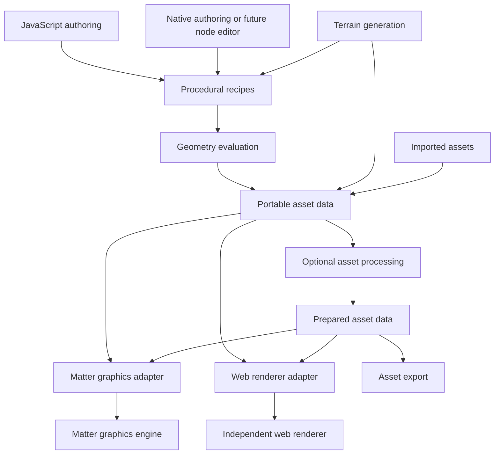

# Matter Engine component separation design

## Purpose and agreed direction

Extract Matter Engine's procedural geometry capabilities into independently usable components, with native C++ and browser WebAssembly builds. Separate the graphics engine completely from generation. Terrain may consume procedural geometry, while its generation and runtime coordination remain independent of rendering.

The user prefers browser JavaScript calling a portable geometry implementation. QuickJS may remain the initial native script host, but replacing it must not require changing geometry algorithms, asset data, or the renderer. JavaScript is an authoring interface; the shared procedural contract is language independent.

The agreed architectural direction is:

- Procedural geometry works without a graphics engine, editor, or live world.
- The graphics engine works with imported and hand-built assets without the procedural system installed.
- Terrain generation can use procedural geometry and can feed a different renderer.
- An application or world coordinator connects generation, storage, simulation, and rendering through explicit interfaces.
- Components share one implementation across native and browser consumers where practical.

The detailed interfaces below are proposed design choices for review. This design does not authorize implementation, create AQ tasks, select a replacement JavaScript engine, or change the existing review statuses. AQ work decomposition follows a separate discussion.

## Scope and relationship to earlier proposals

This design refines the component architecture in the October 1 MakerScript pivot proposal. It changes the preferred browser execution approach to browser JavaScript plus WebAssembly geometry, with a replaceable native script adapter. The earlier proposal remains historical context; its commercial service, optimization claims, advanced rendering experiments, and launch plan are outside this extraction.

The intended result is reusable generation and graphics libraries. Package names, public branding, licensing, repository separation, and distribution policy remain open. Begin with independently buildable targets in the existing Matter repository so the engine and extracted libraries use the same source implementations.

## Component ownership

| Component | Owns | Public boundary |
| --- | --- | --- |
| Shared data contracts | Math conventions, identifiers, diagnostics, recipes, portable asset descriptions | Versioned value types and buffers with explicit ownership |
| Authoring SDK | Parameters, composition helpers, recipe construction, explicit seeded randomness | Recipes and declared dependency requests |
| Script host | Language execution, module loading, host bindings, execution limits, source diagnostics | Runs authoring code against supplied capabilities |
| Geometry library | Primitives, CSG, triangulation, meshing, modifiers, spatial queries | Recipes or geometry in; geometry and diagnostics out |
| Asset processing | LOD preparation, UV processing, texture baking, optimization, supported animation preparation | Explicit asset inputs and processing settings |
| Assembly and build coordinator | Dependency evaluation, shared parts, job scheduling, cache policy, cancellation | Build requests and immutable results |
| Terrain generation | Field evaluation, terrain composition, chunk generation, boundary information, available detail levels | Explicit region inputs and terrain products |
| Graphics engine | Graphics resources, visibility, drawing, lighting, shadows, ray tracing, visual effects, resource residency | Scene updates and renderer-supported asset data |
| Application and world coordinator | World state, generation requests, chunk lifetimes, simulation integration, result admission | Connects independent services |
| Storage and export adapters | Cache persistence, artifact packaging, file import and export | Portable data to and from a target format or store |

These are responsibility boundaries, not a requirement for one repository, service, or binary per row. Small related modules may ship together while retaining independent build dependencies.

### Data flow



Arrows describe data flow. A consumer of portable asset data depends on the data contract, without linking the code that produced it.

### Dependency rules

1. Shared contracts have no dependency on QuickJS, a renderer, ECS, filesystem implementation, or platform windowing library.
2. Geometry depends on shared contracts and explicitly selected algorithm libraries. Native and WASM bindings are adapters around that implementation.
3. Script execution belongs above the geometry boundary. No JavaScript context or engine-specific value may appear in a geometry interface.
4. Terrain may call geometry. Geometry has no dependency on a terrain runtime or world singleton.
5. Graphics depends on its scene and asset contracts. It never invokes a procedural or terrain generator.
6. Storage, scheduling, and application policy remain outside geometry algorithms. Geometry evaluation does not implicitly write a cache file or upload resources.
7. Target adapters own conversion into GPU buffers, acceleration structures, renderer materials, and export layouts.
8. Optional capabilities must be independently selectable. A basic prop generator must build without terrain, physics, animation, or GPU rendering support.

## The two central data contracts

### Procedural recipes

A recipe describes construction: primitives, transforms, CSG operations, profiles and extrusions, mesh inputs, modifiers, material references, and assembly references. It contains explicit inputs and declared operation semantics. Native pointers, script closures, renderer handles, and live world objects cannot be recipe payloads.

The first recipe model should cover a bounded useful subset. Fields, scattering, physics-assisted placement, and animation can extend that model through named capabilities and versioned structures. Unknown required operations fail with a specific diagnostic. The library must not silently omit unsupported geometry.

Recipe nodes need identities that diagnostics can map back to an authored part or source location. Stable semantic identifiers and content hashes serve different purposes: the former identify a part across edits; the latter identify exact inputs or outputs for caching.

The recipe contract is distinct from any GPU buffer layout or disk format. Implementations may lower it into packed operation tapes, mesh jobs, or device-specific structures.

### Portable asset data

The output contract describes a constructed asset:

- Mesh positions, indices, normals, tangents, texture coordinates, bounds, and material slots.
- Shared prototypes and separate instance placements, preserving hierarchy where applicable.
- A defined material description subset and texture references with color-space information.
- Optional attachment points, collision descriptions, rigs, skin data, and animation clips.
- Provenance, required capabilities, diagnostics, and representation metadata.

Use documented units, coordinate conventions, winding, matrix layout, and transform composition. Start from compatibility with existing Matter conventions and make conversions explicit. Mirrored and nonuniform transforms require dedicated examples.

An asset may preserve a recipe or field as an optional representation alongside prepared meshes. A graphics consumer must explicitly support that representation or request a prepared fallback through the application. The graphics engine must never need to execute arbitrary authoring code to display an asset.

GPU buffers, BLAS/TLAS managers, graphics device handles, cache-publication flags, and live sector state are outside the portable asset contract. Renderer-specific derived data may be cached separately and keyed by asset identity plus backend/version information.

## JavaScript and native execution

The preferred browser path is:

```text
JavaScript authoring SDK
    -> recipe construction
    -> explicit geometry evaluation through WASM
    -> portable results
    -> browser rendering adapter
```

The native path uses the same recipe semantics and C++ geometry library. QuickJS initially executes the authoring SDK through a native adapter. The SDK must avoid ambient browser dependencies so another native JavaScript host can replace it. Browser, filesystem, and network access belong to host integration modules.

Give geometry a narrow C-compatible binding surface with explicit error returns, opaque result handles where needed, and documented buffer lifetimes. A TypeScript wrapper provides ergonomic asynchronous operations. Internal C++ implementation types remain private, and exceptions do not cross the binding boundary.

The exact binding mechanism remains an implementation choice. Emscripten supports function calls and direct access to compiled memory; that support does not remove the need for ownership rules. Memory growth or disposal can invalidate borrowed views. Prefer a clear copy or transfer boundary initially, then optimize measured costs. [Emscripten interoperability documentation](https://emscripten.org/docs/porting/connecting_cpp_and_javascript/Interacting-with-code.html)

### Staged evaluation and queries

A single recipe submission is useful, but some generators need intermediate geometry results. For example, generate a surface, sample positions and normals, and place details at those samples.

Support explicit stages conceptually equivalent to:

```text
evaluate(recipe, settings) -> geometry result
sample(geometry result, query batch) -> positions and normals
evaluate(next recipe using query results, settings) -> next result
```

Queries are bounded and batchable. Avoid requiring a JavaScript callback for every mesh vertex or field sample. Field programs intended for native or GPU evaluation need a supported portable representation.

### Determinism and compatibility

Define seeded random behavior, parameter normalization, ordering, and algorithm versions explicitly. Do not promise identical geometry bytes across native and WASM merely because they share C++ code. Fixtures distinguish exact recipe/metadata equality from geometry equivalence within recorded tolerances.

Cache keys include relevant dependencies, canonical parameters, seed, recipe and algorithm versions, generation settings, and target processing settings. An exact prepared artifact is the appropriate distribution unit when consumers require identical output bytes.

Existing scripts receive an explicit compatibility path. Unsupported legacy operations must report their status. Compatibility does not require keeping QuickJS-owned APIs in the new geometry contract.

## Terrain and world coordination

Terrain generation owns fields, composition rules, generation resolution, chunk geometry, and seam or boundary information. Its inputs describe a region and the data needed to evaluate it. It must not reach into a live renderer or assume a resident world object.

Terrain products may include renderable geometry, collision inputs, bounds, field summaries, and boundary metadata. These products have separate consumers. Physics and navigation can consume terrain results without starting graphics.

The application/world coordinator owns residency policy and job admission. A typical cycle is:

1. Visibility or application policy identifies a desired region and detail level.
2. The coordinator loads a cached product or schedules generation.
3. Terrain requests geometry through the library's public contract.
4. The coordinator checks that the completed result still matches the requested world revision and generation.
5. The relevant adapters publish geometry to graphics, collision to physics, and cacheable products to storage.

Graphics can report visible bounds, projected error, resource pressure, or demand for a representation. These are observations for the coordinator. They do not give graphics ownership of terrain scheduling.

Generation detail levels and renderer LOD selection are separate responsibilities. The generator or processing stage prepares valid representations and error information. Graphics selects among available representations; the coordinator handles unavailable ones. Late or cancelled results must not replace a newer revision.

Terrain definitions, CPU caches, collision products, and GPU resources have independent lifetimes. Evicting a GPU chunk must not destroy the terrain source definition.

## Graphics engine boundary

The graphics engine accepts scene changes and supported assets through an explicit upload/update interface. It owns GPU allocation, upload synchronization, rendering acceleration structures, culling, render passes, lighting, shadows, and renderer-specific resource management.

The Matter graphics adapter converts portable data into those resources. Procedural provenance is optional metadata. Imported meshes and manually constructed scene data exercise the same graphics interface.

Renderer material implementations and procedural surface generation need separate ownership. A portable material description expresses the supported appearance inputs; an adapter supplies the renderer implementation. Matter-specific relief, virtual textures, or other advanced representations must declare their capability requirements and conversion/fallback policy. Ordinary material output remains independently usable.

### GPU assisted generation

A GPU mesher can be an optional geometry backend with a narrow compute interface. It must not require the graphics engine's scene, material system, or frame loop. Shared low-level device infrastructure can sit below both systems if its dependency direction is explicit.

Start with a portable CPU result path. An optional device-local handoff can later avoid readback and re-upload, with explicit device compatibility, synchronization, ownership, and lifetime rules. The optimized handoff cannot become the only supported geometry interface.

## Evidence from the existing code

The inspected checkout is `/mnt/d/Shared With Desktop/AI/matter-engine-cpp`, HEAD `d006f20e91e4193d9b6e5a3dd2a165e2c3171143`. These observations come from the visible source files; uncommitted source state was not audited and no extraction build has been demonstrated.

| Existing source | Observation | Extraction implication |
| --- | --- | --- |
| `MatterEngine3/src/part_graph.h` | Resolver and baker interfaces already separate dependency traversal from source evaluation and baking | Reuse the graph boundary; keep cache and host services behind interfaces |
| `MatterEngine3/src/dsl_state.h` | Authoring state includes raylib tint types, terrain runtime pointers, animation and rendering-related declarations | Split neutral recipe/build state from optional domain extensions and host bindings |
| `MatterEngine3/src/script_host.cpp` | Includes script bindings, geometry, animation preparation, artifact storage and renderer headers | Separate execution, evaluation, processing and publication |
| `MatterEngine3/src/render/part_store.h` | `BakedGeometry` contains a BLAS manager, render policy and publication metadata | Introduce portable output contracts; moving the struct alone would preserve coupling |
| `MatterEngine3/src/script_host.h` | `EvaluatedSolidSource` separates owned recipe evaluation from meshing/publication | Useful extraction precedent, with GPU-oriented contracts to generalize |
| `MatterEngine3/include/matter/solid_sdf_meshing.h` | Ordered solid operations have a fixed GPU ABI and bounded jobs | Keep this as a backend lowering target rather than making the GPU ABI the authoring contract |
| `cmake/manifests/engine-core.sources` | One archive spans authoring, terrain, renderer, ECS and processing code | Establish explicit build targets and transitive dependency checks |

## Enforcing the boundaries

Independence must be demonstrable through builds and behavior:

- Build and run geometry tests without QuickJS, Vulkan, raylib, an ECS, or the editor.
- Build a graphics sample using imported or synthetic assets without procedural or terrain libraries.
- Generate terrain products in a headless tool and display them through an independent renderer.
- Compile the chosen geometry subset to WASM and execute it through browser JavaScript.
- Keep forbidden includes and dependencies out of each target's public interface and transitive link graph.
- Test recipe validation, ownership, cancellation, stale-result admission, instance identity, coordinate conversion, and unsupported capabilities at their owning boundaries.

Use shared semantic fixtures for authoring and native/WASM equivalence. Reuse existing Matter fixtures where they express intended behavior. Preserve a record of compatibility gaps rather than hiding them behind adapter defaults.

## Extraction strategy and acceptance

Establish contracts before broad file moves. Extract a small end-to-end slice while Matter continues to consume the shared implementation. The first slice should contain a primitive or extrusion, a CSG operation, a material assignment, and a repeated child assembly. Add terrain once the geometry and renderer interfaces are demonstrably independent.

The slice is accepted when:

1. Browser JavaScript and the current native host produce equivalent recipes for the selected fixtures.
2. Native and WASM geometry outputs meet defined equivalence checks.
3. Matter and an independent web renderer display the outputs through their respective adapters.
4. Instance sharing, transforms, materials, diagnostics, and resource disposal retain their intended semantics.
5. A native headless generator and a graphics-only sample build independently.
6. Download size, generation latency, memory, and data-copy costs are measured on named environments; numerical budgets are agreed before claiming performance success.

Extend coverage through further representative slices, including terrain boundaries and optional processing. Keep one source implementation for extracted algorithms. Retire legacy paths after their replacements pass compatibility and consumer checks.

These are migration principles and acceptance boundaries. Task sizes, dependency ordering, AQ assignments, integration policy, and rollout gates remain for the subsequent implementation-planning discussion.

## Open decisions for implementation planning

| Decision | Proposed starting point | What remains to resolve |
| --- | --- | --- |
| Recipe expressiveness | Bounded geometry operations with explicit domain extensions | First supported operations, fields, queries and graph semantics |
| JavaScript authoring compatibility | Shared portable SDK with temporary QuickJS adapter | Existing syntax coverage, import behavior and native host constraints |
| Portable material scope | Defined conventional material subset | Advanced surface requirements and fallback behavior |
| First terrain boundary | Explicit field/region inputs and generated chunk products | Field representation, seam guarantees and LOD transitions |
| Optional modules | Independently selectable animation, physics and GPU backends | Which are required by the initial representative generators |
| ABI and packaging | Narrow bindings and separate native/WASM targets in one repository | Result ownership details, distribution layout and version policy |
| Performance goals | Measure representative fixtures first | Target browsers/devices, latency, memory and payload budgets |
| Native JavaScript replacement | Preserve a replaceable host interface | Evaluate alternatives later against actual host requirements |

## References

- [MakerScript pivot and implementation plan](../plans/2026-10-01-makerscript-pivot-and-implementation-plan.md), October 1, 2026.
- [MatterEngine plugin feasibility research](2026-10-01-matterengine-openai-plugin-feasibility-research.md), October 1, 2026.
- Matter repository source paths listed in the evidence table.
- [Emscripten interoperability documentation](https://emscripten.org/docs/porting/connecting_cpp_and_javascript/Interacting-with-code.html).
- User architecture discussion on October 10, 2026: browser JavaScript plus WASM geometry, replaceable QuickJS, independent graphics, and terrain consuming geometry through explicit boundaries.

## Implementation preparation

On October 10 the user authorized preparation of shared contracts and creation of the full AQ implementation graph, with one epic per parallel track and the project kept paused. The [contracts v1 specification](2026-10-10-matter-component-contracts-v1.md) supplies concrete interface decisions. The [implementation plan](../plans/2026-10-10-matter-component-separation-implementation-plan.md) records ownership, prerequisites and acceptance criteria. This authorization does not claim that code extraction has already been implemented.
