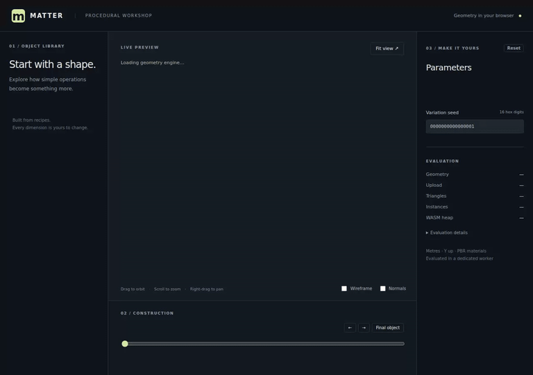

# Browser integration evidence · 2026-10-14

Real Matter geometry WASM, production Vite build, Playwright 1.58.2 Chromium
with software WebGL2 on Linux, Node 24.15.0. Source base:
`c57ba76866d811e285457439380b57a01eebe717`. Generated engine binaries stay ignored.

- Gallery smoke: **12.098 seconds**, including browser start/stop;
  thirteen visible objects, one reused module worker, a real WASM request,
  and no browser/HTTP errors. Each object is compared with an empty canvas
  at the same camera/grid position; status/toolbar strips are excluded.
- Interaction gate: **37.62 seconds**, all **112 construction stages**,
  parameter edits, cancellation, invalid seed/reset, display modes and mobile layout.
- Native LOD: maximum chain reduces **1,944 → 666 triangles**
  on zoom-out and restores full geometry with Fit view.
- Frontend unit checks: **8 passed**, including heavy-result LOD caching and stale-result rejection.
- `npm run build`: TypeScript and production build passed. Vite's existing
  single-bundle size advisory remains (645.47 kB minified, 164.80 kB gzip).

Exact commands and bundle hash: [verification.json](verification.json).
Native compiler/tools/WASM hash: [wasm-build.json](wasm-build.json).
Detailed browser stages/LOD: [browser.json](browser.json).
Smoke pixel counts/worker/time: [smoke.json](smoke.json).

| Object screenshot | Full triangles | Object pixels |
| --- | ---: | ---: |
| [rock](rock.png) | 72 | 63,992 |
| [tree](tree.png) | 480 | 26,913 |
| [pillar](pillar.png) | 212 | 93,583 |
| [arch](arch.png) | 792 | 78,032 |
| [gear](gear.png) | 352 | 84,561 |
| [vase](vase.png) | 384 | 75,039 |
| [chair](chair.png) | 156 | 86,296 |
| [crystals](crystals.png) | 168 | 42,657 |
| [stairs](stairs.png) | 60 | 74,230 |
| [chain](chain.png) | 1,080 | 23,942 |
| [terrain](terrain.png) | 192 | 91,643 |
| [facade](facade.png) | 252 | 107,746 |
| [bracket](bracket.png) | 1,480 | 107,744 |

## Construction recording

Seven arch stages, including the original final recipe output.
Reproduce with `npm run capture:construction`; GIF export command is in the
application README. [Stage labels](construction.json).

## Workshop captures

[Chair and controls](chair-workshop.png), [wireframe and normals](arch-wireframe-normals.png),
[reduced chain](chain-lod.png), [mobile layout](mobile.png).

These captures verify this browser/software-renderer configuration; they do
not establish performance on every physical GPU. The longer interaction and
recording commands are deliberately separate from the strict 20-second smoke.
